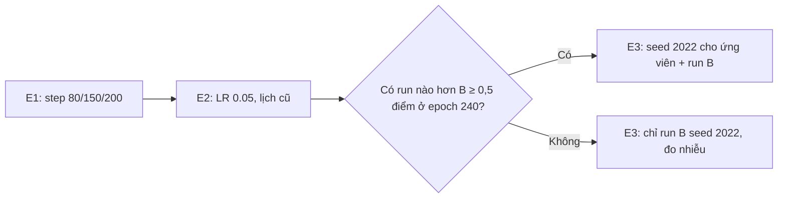

# E — Lịch learning rate (nền run B) — KẾ HOẠCH

Ghi chú: kế hoạch do người dùng duyệt ngày 2026-11-03 (bỏ phương án cosine + warmup). **D (DOT) tạm dừng**: code đã sẵn sàng ở commit `3c9fea4`
(`OPTIM_MODE=dot`, notebook `kaggle/experiments/d_dot.ipynb`), chạy lại sau nếu người dùng yêu cầu.

## Bối cảnh
A1, A2, A3, B (Logit Standardization), C (DKD) đều chưa vượt run B (70.26% best / 70.04% final, 1 seed). Câu hỏi tiếp theo: lịch LR có phải điểm nghẽn không?
Quan sát từ log: ở LR 0.1 (epoch 1–150) test top-1 dao động ~38–50%, rồi nhảy lên ~62–64% sau lần giảm LR đầu tiên. Đây là hình dạng bình thường của step LR
(LR cao giúp khám phá, giảm LR giúp hội tụ), **chưa chứng minh** LR 0.1 quá cao; lịch 150/180/210 cũng là lịch chuẩn của KD trên CIFAR-100. Vì vậy E là phép thử, chưa phải kỳ vọng chắc chắn.

## Nền cố định (giống run B)
CE/KD/BC 0.5/0.5/0.5 (`LAMBDA_BC` mặc định = `kd_weight`), KD mask scalar, T=4, tik 0.1, SGD momentum 0.9, weight decay 5e-4, batch 64, 240 epoch,
weak + strong augmentation, teacher ResNet56 71.59%, dataset `fedesoriano/cifar100` v1, GPU T4, Docker image như run B. **Mỗi run chỉ đổi một yếu tố.**

## Các run
| Run | Thay đổi so với run B | Câu hỏi |
|---|---|---|
| **E1** | Step LR 0.1, giảm ×0.1 ở epoch **80 / 150 / 200** (thay vì 150 / 180 / 210) | Giữ LR cao 150 epoch có quá lâu không? |
| **E2** | LR khởi đầu **0.05**, giữ lịch 150 / 180 / 210 | Bản thân LR 0.1 có quá cao không? (0.05 là LR chuẩn của CRD/DKD/mdistiller cho student ResNet20) |
| **E3** | Chạy lại **ứng viên tốt nhất (nếu đạt ngưỡng) và run B** với **seed 2022** | Chênh lệch có vượt nhiễu seed không? |

Phương án đã cân nhắc và bỏ: cosine annealing + warmup 5 epoch (người dùng quyết định bỏ).

## Chỉ số và luật quyết định
- Chỉ số chính: **test top-1 ở epoch 240**. Phụ: best top-1 (có selection bias vì chọn trên test set) và **trung bình 10 epoch cuối** (ổn định hơn, tính từ log).
- Một ứng viên chỉ được coi là "tốt hơn B" nếu epoch-240 top-1 **cao hơn B ≥ 0,5 điểm** (lớn hơn nhiễu ~0,3 của 1 seed) **và** giữ được ở E3 với seed 2022.
- Nếu không ứng viên nào đạt ngưỡng: E3 vẫn chạy **run B seed 2022** để đo nhiễu seed thực tế (chỉ 1 run), rồi kết luận "lịch LR không phải điểm nghẽn".

## Thay đổi code dự kiến (mặc định giữ nguyên bit như run B)
Biến môi trường mới: `LEARNING_RATE` (mặc định `0.1`), `LR_MILESTONES` (mặc định `150,180,210`), `SEED` (mặc định `2021`). Scheduler vẫn cập nhật theo epoch (MultiStepLR, gamma 0.1).
Test CPU trước khi submit: (1) mặc định cho trọng số bit-exact so với commit trước; (2) in bảng LR từng epoch của E1/E2 và so với bảng tính tay
(E1: epoch 1–80 = 0.1, 81–150 = 0.01, 151–200 = 0.001, 201–240 = 0.0001; E2: 0.05 / 0.005 / 0.0005 / 0.00005 tại các mốc 150/180/210).

## Tài khoản Kaggle và ngân sách
- Chạy trên **tài khoản 2** (`kitit5512trn`): CLI dùng `export KAGGLE_API_TOKEN="$KAGGLE_KEY2"`; Kaggle MCP trong session đã chuyển sang tài khoản 2.
  Notebook slug dạng `kitit5512trn/streamlined-kd-cifar100-e<n>-<tên>`. Kết quả cũ của tài khoản 1 (`trananhkiet`) đọc bằng CLI với `KAGGLE_KEY`.
- Đọc kết quả bằng `kaggle kernels logs <slug>` (lọc trong shell) hoặc MCP `list_notebook_session_output`; host `www.kaggleusercontent.com` vẫn bị chặn nên chưa tải được `history.csv`.
- Lần submit đầu trên tài khoản 2 phải xác minh: dataset attach đúng và Docker image ghim của run B dùng được. Nếu image bị từ chối: dừng, ghi blocker, **không tự đổi image**.
- Mỗi run ~3,9h GPU. E1 + E2 ≈ 8h, E3 ≈ 4–8h → tổng ≈ 12–16h, nằm trong 30h/tuần của tài khoản 2 (refresh 2026-11-07 00:00 UTC).

## Implement và kiểm tra (2026-11-03, lần trigger 16:27 UTC)
Ghi chú: session tự động (scheduler v5); không hỏi lại.
- `kaggle/streamlined_kd_cifar100.py`: `SEED` (mặc định 2021), `LEARNING_RATE` (mặc định 0.1), `LR_MILESTONES` (mặc định `150,180,210`, parse thành tuple int) trong `Config`.
  `SEED` đi qua mọi chỗ dùng `CFG.seed` (seed_everything, worker seed, generator của DataLoader, re-seed trước khi tạo student).
- Test CPU: (1) `asdict(CFG)` mặc định giống hệt commit `561b5ea`; trọng số sau 2 epoch nhỏ trên dữ liệu giả **bit-exact** (sai lệch 0);
  (2) chạy module trong interpreter mới với từng env và in LR của 240 epoch qua `MultiStepLR` như `run_experiment`, so với bảng tính tay: **khớp cả 240 epoch** cho
  run B (0.1 → 0.01 từ ep151 → 0.001 từ ep181 → 0.0001 từ ep211), E1 (0.1 → 0.01 từ ep81 → 0.001 từ ep151 → 0.0001 từ ep201), E2 (0.05 → 0.005 từ ep151 → 0.0005 từ ep181 → 5e-5 từ ep211), seed 2022.
- Notebook E1: `kaggle/experiments/e1_step80_150_200.ipynb`, khác notebook nền đúng một dòng (`LR_MILESTONES` mặc định `80,150,200`).

## E1 — lần submit 1 (2026-11-03 16:30 UTC): ERROR, BLOCKER tài khoản 2 không có GPU
- Notebook: https://www.kaggle.com/code/kitit5512trn/streamlined-kd-cifar100-e1-step80-150-200 — version 1, code commit `82cbcbd`.
- `kaggle kernels pull -m` xác nhận `dataset_sources=["fedesoriano/cifar100"]`, `docker_image` đúng bản ghim của run B, `machine_shape=NvidiaTeslaT4` → **dataset và Docker image dùng được trên tài khoản 2**.
- Log: `PyTorch: 2.11.0+cu128`, **`device: cpu`**, rồi script tự dừng sau ~38 giây ở kiểm tra GPU
  (`RuntimeError: This 240-epoch experiment requires a Kaggle GPU`). Không train trên CPU, không tốn GPU quota.
- Nguyên nhân khả dĩ nhất (chưa xác minh trực tiếp): tài khoản 2 chưa được bật GPU — thường do **chưa xác minh số điện thoại** trên Kaggle (GPU/TPU chỉ dùng được sau khi verify).
  Đây là blocker môi trường, không phải lỗi code; sửa code không giúp được.
- Theo quy tắc: không tự chuyển sang tài khoản 1, không đổi image. Lần thử này ghi là **retry 0/3** (blocker quyền, không phải lỗi run).

## E1 — lần submit 2 (2026-11-03 16:46 UTC): RUNNING trên GPU
- Người dùng đã xử lý quyền GPU của tài khoản 2. Push lại cùng notebook (không đổi nội dung) → **version 2**, cùng slug, code commit `82cbcbd`.
- Xác minh: trạng thái RUNNING sau >4 phút (version 1 bị ERROR trước giây thứ 40), và quota GPU tài khoản 2 bắt đầu bị trừ (0.07h dùng lúc 16:50 UTC) → kernel chạy trên GPU.
  Dataset và Docker image đã xác minh ở version 1 (cùng metadata).
- Lần submit 1 (ERROR vì không có GPU) không tính là retry.

## Kết quả E1 (step 80/150/200) — đã xác minh từ log Kaggle (tài khoản 2, version 2), 2026-11-04
Config xác nhận trong `summary.json`: `seed=2021`, `learning_rate=0.1`, `lr_milestones=[80,150,200]`, CE/KD 0.5/0.5, `kd_mask_mode=scalar`, `lambda_bc=-1`, `loss_mode=skd`, `optim_mode=sgd`, T=4.
Log: `device: cuda`, CIFAR-100 từ dataset đã attach, teacher 71.59%.

| | Run B (150/180/210) | **E1 (80/150/200)** | E1 − B |
|---|---:|---:|---:|
| **Test top-1 epoch 240 (chỉ số chính)** | 70.04% | **70.75%** | **+0.71** |
| Trung bình 10 epoch cuối (231–240) | 70.07% | **70.68%** | **+0.61** |
| Best test top-1 (có selection bias) | 70.26% (ep 235) | **70.79%** (ep 239) | +0.53 |
| Best test top-5 | 92.32% | **92.65%** | +0.33 |
| Best test loss | 1.0730 | **1.0405** | −0.033 |
| Train top-1 cuối | 66.73% | 68.26% | +1.53 |
| Runtime | — | 13.975 s (~3,88 giờ) | |
(Trung bình 10 epoch cuối của run B tính lại từ log của tài khoản 1 `trananhkiet/streamlined-kd-cifar100-ce05-kd05`.)

Đường cong E1: ep80 41.50% → ep81 **62.63%** (lần giảm LR đầu sớm hơn 70 epoch) → ep150 64.07% → ep151 68.49% → ep200 69.73% → ep201 70.20% → ep240 70.75%.
Ở run B: ep150 38.06% → ep151 62.63% → ep181 67.66% → ep211 70.05% → ep240 70.04%.

### Bài học (E1, 1 seed)
- **Kết quả tốt nhất cho đến nay** và là run đầu tiên vượt luật ngưỡng (+0,71 ở epoch 240, +0,61 ở trung bình 10 epoch cuối, đều > 0,5). Top-5 và test loss cũng tốt hơn rõ, nên không phải một chỉ số lẻ.
- Rút ngắn giai đoạn LR 0.1 (150 → 80 epoch) và cho nhiều epoch hơn ở LR 0.01/0.001 (70 + 50 thay vì 30 + 30) giúp student hội tụ tốt hơn;
  giai đoạn LR 0.01 đạt ~64% (cao hơn đỉnh LR 0.01 của run B ~63%), và giai đoạn LR 0.001 dài hơn đưa lên ~69,7–70,2% trước lần giảm cuối.
- Train top-1 cao hơn B 1,5 điểm và test cũng cao hơn: E1 khớp dữ liệu tốt hơn mà không làm giảm tổng quát.
- Cảnh báo: mới 1 seed; luật quyết định yêu cầu giữ được ở seed 2022 (E3) trước khi kết luận. Khoảng cách tới paper (72,5%) còn ~1,75 điểm.
- Theo luật: E1 đạt ngưỡng → E3 sẽ chạy **E1 seed 2022** và **run B seed 2022** (sau E2; nếu E2 tốt hơn E1 thì ứng viên E3 là E2).

## E2 (LR 0.05) — chuẩn bị
Notebook `kaggle/experiments/e2_lr005.ipynb`, khác notebook nền đúng một dòng (`LEARNING_RATE` mặc định `0.05`); bảng LR đã kiểm tra ở bước implement (0.05 → 0.005 từ ep151 → 0.0005 từ ep181 → 5e-5 từ ep211).

## Kết quả E2 (LR 0.05, lịch 150/180/210) — đã xác minh từ log Kaggle (tài khoản 2, version 1), 2026-11-04
Config xác nhận trong `summary.json`: `seed=2021`, `learning_rate=0.05`, `lr_milestones=[150,180,210]`, còn lại như run B. Log: `device: cuda`, dataset attach OK, teacher 71.59%.

| | Run B | E1 | **E2** | E2 − B |
|---|---:|---:|---:|---:|
| **Test top-1 epoch 240** | 70.04% | 70.75% | **70.14%** | +0.10 |
| Trung bình 10 epoch cuối | 70.07% | 70.68% | **70.36%** | +0.29 |
| Best test top-1 | 70.26% | 70.79% | **70.59%** (ep 234) | +0.33 |
| Best test top-5 | 92.32% | 92.65% | 92.43% | +0.11 |
| Best test loss | 1.0730 | 1.0405 | 1.0423 | −0.031 |
| Train top-1 cuối | 66.73% | 68.26% | 67.45% | +0.72 |
| Runtime | — | 13.975 s | 14.220 s (~3,95 giờ) | |

Đường cong E2: giai đoạn LR 0.05 test dao động ~45–57% (cao hơn rõ mức 38–48% của LR 0.1) → ep151 65.49% → ep181 69.27% → ep200 70.23% → ep211 70.25% → ep240 70.14%.

### Bài học (E2, 1 seed)
- Hạ LR khởi đầu xuống 0.05 làm giai đoạn đầu "đẹp" hơn nhiều (test cao hơn ~10 điểm trước lần giảm LR đầu), nhưng **kết quả cuối gần như bằng run B**
  (+0,10 epoch 240, +0,29 trung bình 10 epoch cuối) — **không đạt ngưỡng +0,5**. Xác nhận rằng độ "dao động" ở LR 0.1 không phải vấn đề tự thân.
- Test loss của E2 tốt gần bằng E1, nhưng top-1 thấp hơn E1 ~0,3–0,6 điểm. Thứ có ích ở E1 là **phân bổ lại số epoch** (giai đoạn LR thấp dài hơn), không phải LR khởi đầu nhỏ hơn.
- Epoch 240 của E2 (70.14) thấp hơn trung bình 10 epoch cuối (70.36) ~0,2 điểm: minh họa nhiễu giữa các epoch cuối, nên trung bình 10 epoch cuối là chỉ số phụ hữu ích.

## E3 — chọn ứng viên theo luật quyết định
- E1 epoch 240 = 70.75 ≥ 70.54 (B + 0.5) → **đạt**; E2 = 70.14 → không đạt. **Ứng viên = E1.**
- E3 gồm 2 run, mỗi lần trigger một run: (1) **E1 seed 2022** — slug `streamlined-kd-cifar100-e3-e1-seed2022`
  (tên ngắn cho dưới giới hạn ~50 ký tự của Kaggle; đúng mẫu `e3-<tên-ứng-viên>-seed2022`), notebook `kaggle/experiments/e3_e1_seed2022.ipynb`
  khác notebook E1 đúng một dòng (`SEED` mặc định `2022`); (2) **run B seed 2022** — slug `streamlined-kd-cifar100-e3-runb-seed2022`.
- Kết luận E sẽ so cặp cùng seed: (E1 − B) ở seed 2021 = +0.71; nếu (E1 − B) ở seed 2022 cũng ≥ +0.5 thì coi E1 tốt hơn B thật.

## Trạng thái
E1, E2 xong. E3 run 1 (E1 seed 2022) sắp submit. Xem EXPERIMENT_HANDOFF.md (mục "TRẠNG THÁI HIỆN TẠI").
