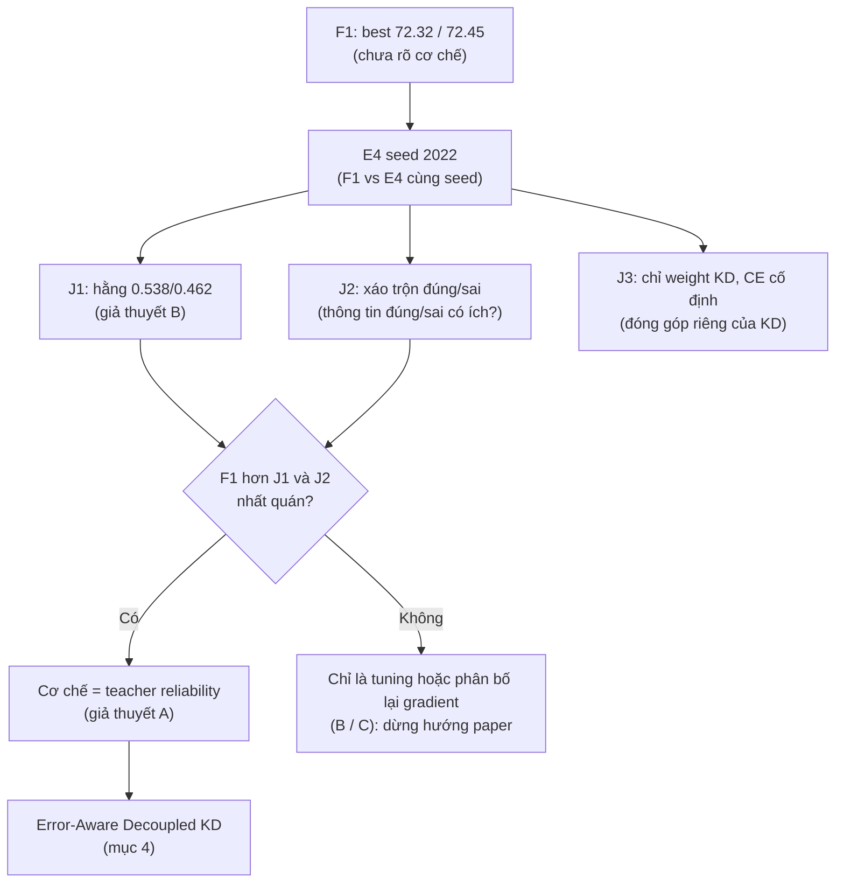

# Hướng nghiên cứu: tìm cơ chế đằng sau F1, rồi đề xuất loss có tính mới (Error-Aware Decoupled KD)

Người dùng đề xuất (2026-11-12). **Đây là hướng nghiên cứu (kế hoạch), chưa có run nào được submit.** Các mục có nhãn "Ghi chú của Claude" là phần bổ sung kiểm chứng/rủi ro, không phải ý của người dùng.

Mục tiêu: không chỉ thử các hệ số kiểu 0.55/0.45 hay 0.65/0.35, mà **tìm ra vì sao F1 cải thiện accuracy**, rồi dựa vào nguyên nhân đó để đề xuất một loss có tính mới cho paper.

## 1. F1 thực sự đang làm gì?

Công thức F1 (đã bỏ hệ số mask chung của nhánh KD cho dễ đọc; implementation vẫn giữ hệ số này):

$$L=\frac1B\sum_i(1-w_i)\,CE_i+\frac1B\sum_i w_i\,KD_i+\lambda_{BC}\,L_{BC}$$

với $w_i = 0.6$ nếu teacher dự đoán đúng ảnh $i$, và $w_i = 0.4$ nếu teacher dự đoán sai.

| Teacher | Trọng số CE | Trọng số KD | Ý nghĩa |
|---|---:|---:|---|
| Dự đoán đúng | 0.4 | 0.6 | Tin teacher nhiều hơn |
| Dự đoán sai | 0.6 | 0.4 | Tin nhãn thật (ground-truth) nhiều hơn |

Kết quả F1 đã có (best top-1, teacher mdistiller 72.41, 300 epoch): **seed 2021 = 72.32**, **seed 2022 = 72.45** (E4 seed 2021 = 72.10; paper SKD = 72.50).
Nhưng **chưa biết cải thiện đến từ đâu**.

## 2. Ba giả thuyết cần kiểm chứng

- **A — Độ tin cậy của teacher (teacher reliability):** student học tốt hơn khi giảm KD trên những mẫu teacher dự đoán sai.
- **B — Thay đổi trọng số KD chung:** teacher đúng khoảng 69.2% ảnh train (đã đo; ~30.8% sai) nên trọng số KD trung bình của F1 ≈ 0.6·0.692 + 0.4·0.308 ≈ **0.538** (CE ≈ 0.462) thay vì 0.5. Có thể chỉ cần tăng KD chung là đủ.
- **C — Cân bằng CE/KD theo độ khó:** F1 có thể hữu ích không phải nhờ đúng/sai của teacher mà nhờ phân bố lại gradient giữa CE và KD trên các nhóm mẫu.

Ba cơ chế này khác nhau. Nếu không phân biệt được, reviewer (người phản biện paper) có thể cho rằng F1 chỉ là tuning (chỉnh siêu tham số).

## 3. Thí nghiệm đề xuất

| Run | Mục tiêu | Ưu tiên |
|---|---|:---:|
| **E4 seed 2022** | Xác nhận mức cải thiện của F1 bằng cặp seed (paired seed): F1 vs E4 cùng seed 2022 | 1 |
| **J1 — trọng số hằng 0.538/0.462** | Kiểm tra giả thuyết B (mọi mẫu CE 0.462 / KD 0.538, không dùng đúng/sai) | 2 |
| **J2 — trọng số đúng/sai bị xáo trộn (shuffled reliability)** | Kiểm tra thông tin đúng/sai của teacher có thật sự hữu ích | 3 |
| **J3 — chỉ weighting KD, CE giữ cố định** | Phân tích đóng góp riêng của phần KD | 4 |

- **J2** hoán vị các trọng số đúng/sai giữa các mẫu trong batch, **giữ nguyên số lượng từng loại trọng số**. Nếu F1 tốt hơn J2 một cách nhất quán, đó là bằng chứng gán trọng số theo teacher correctness có tác dụng, chứ không chỉ do thay đổi phân bố trọng số.
- Mọi run so sánh phải dùng **cùng teacher, lịch LR, augmentation và seed**.

## 4. Khai thác công thức sau khi chứng minh cơ chế

Hướng nghiêng về: **Error-Aware Decoupled Knowledge Distillation**. Thay vì giảm toàn bộ KL khi teacher sai, tách hai loại tri thức:

$$L = CE + \alpha_i\,TCKD_i + \beta_i\,NCKD_i + \lambda\,BC$$

- **TCKD** (Target-Class KD): teacher phân biệt nhãn đúng với phần còn lại.
- **NCKD** (Non-target-Class KD): quan hệ xác suất giữa các lớp không phải nhãn đúng.

**Giả thuyết mới:** khi teacher dự đoán sai, tri thức về lớp đích (target-class) có thể gây hại, nhưng tri thức non-target vẫn có thể hữu ích.
Nếu xác nhận được, thiết kế $(\alpha_i, \beta_i)$ dựa trên **loại lỗi của teacher** thay vì một $w_i$ chung.

**Lưu ý của người dùng:** DKD và RLD đã khai thác ý tưởng liên quan. Tính mới phải nằm ở **cơ chế cụ thể được chứng minh**, không phải chỉ ghép hai loss.

## 5. Ghi chú của Claude (kiểm chứng và rủi ro; không phải ý của người dùng)

1. **Số liệu đã kiểm:** 0.6·0.692 + 0.4·0.308 = 0.538 (khớp). Tỉ lệ teacher đúng khoảng 69% đo từ log run G1/H1 (teacher sai ~30.8–31.0% ảnh train sau augment).
2. **Đóng góp F1 so với E4 hiện còn mỏng.** E4 mới có một seed (2021). F1 − E4 theo best = +0.22 (seed 2021, cùng seed) và +0.35 (seed 2022 vs E4 seed 2021, không cùng seed). Hai seed của F1 lệch nhau 0.13 (best). Nhiễu cỡ 0.1–0.2, nên **E4 seed 2022 là điều kiện** để bất kỳ cơ chế nào có nghĩa (đúng như ưu tiên 1).
3. **Nhiễu khi so J1/J2/J3:** mỗi run chênh nhau cỡ 0.1–0.3 sẽ khó phân biệt với nhiễu. Nên dùng ≥ 2 seed (2021 và 2022) cho mỗi biến thể và so theo cặp seed, hoặc chấp nhận chỉ rút kết luận khi chênh ≥ 0.3 cùng dấu ở cả hai seed.
4. **Chi phí:** mỗi run đầy đủ ~4.6–5.4 giờ GPU. Bốn run ở một seed ≈ 20 giờ; hai seed ≈ 40 giờ. Quota tài khoản 1 còn ~25 giờ (refresh 2026-11-14 00:00 UTC). Cần chia đợt, ví dụ đợt 1 = E4 seed 2022 + J1 + J2 (seed 2022), đợt 2 = các seed 2021 và J3.
5. **Code cần viết:** J1 gần như có sẵn (`SAMPLE_WEIGHT_MODE=teacher_correct` với `SW_TRUST=SW_DISTRUST=0.538`). J2 (hoán vị trọng số trong batch) và J3 (CE cố định 0.5, chỉ weight KD) cần thêm chế độ mới; cần test bit-exact cho các chế độ cũ như các lần trước.
6. **J2 chưa phân biệt được A với C:** đúng/sai của teacher tương quan với độ khó/độ tự tin. Nếu F1 thắng J2, điều đó chỉ chứng minh "thông tin đúng/sai có ích", chưa chứng minh "reliability" thay vì "độ khó". Nên cân nhắc thêm một đối chứng (ví dụ J4: trọng số theo thứ hạng độ tự tin của teacher nhưng không dùng nhãn đúng/sai) để tách A khỏi C.
7. **Bằng chứng nội bộ liên quan:** F2 (0.7/0.3) và F3 (trọng số mềm theo p) không hơn F1, G1 (hoán đổi logit khi teacher sai) không giúp; F4 (nghiêng về CE ở cuối) tăng train top-1 nhưng test không tăng. Các kết quả này nên được giải thích bởi cơ chế mà hướng này tìm ra.
8. **Rủi ro về tính mới:** nhánh nghiên cứu trước (báo cáo `reports/Loss KD CIFAR100 ResNet20.md`) ghi nhận F1 là bản ngưỡng cứng của TGeo-KD (ICLR 2024; chưa kiểm chứng trực tiếp vì không truy cập được arXiv), và RLD (ICCV 2025) bàn về việc không sửa logit teacher sai. Cần đọc trực tiếp các paper này trước khi khẳng định tính mới.
9. **Cơ chế gốc BC:** ở H1/I1, mọi can thiệp bên trong BC đều không giúp (BC chỉ ~1% gradient khi còn `/C`; bật mạnh thì hại). Vì vậy khi thiết kế loss mới, `λ·BC` nên được xem như phần giữ nguyên, không phải nơi tìm cải tiến.

## Trạng thái
Hướng nghiên cứu đã được ghi lại (2026-11-12). **Chưa có run nào được submit.** Việc đầu tiên khi bắt đầu: E4 seed 2022 (ưu tiên 1).
