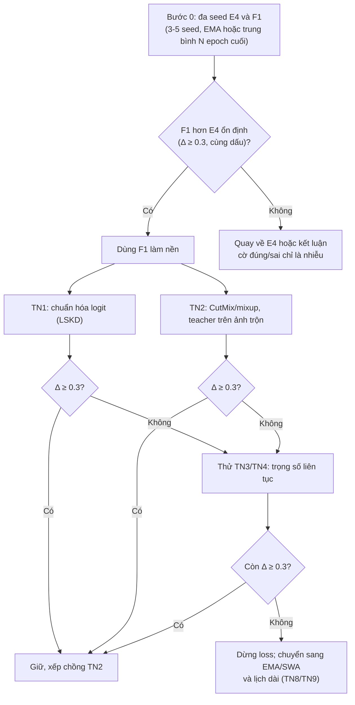
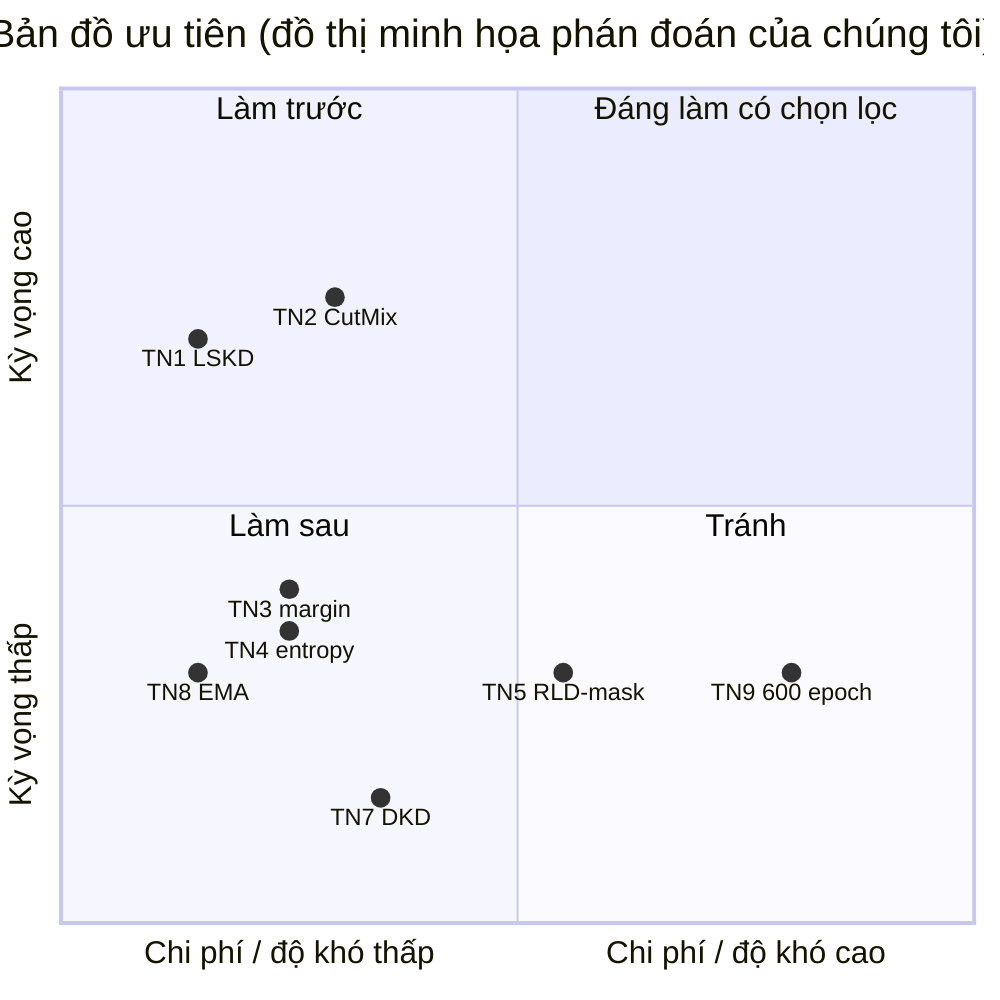

# Vượt F1 trên ResNet20: chỉ còn khoảng trống rất hẹp

**Kết luận chính: F1 (trọng số KD/CE 0.6/0.4 theo độ đúng của teacher, 72.13 cuối / 72.32 tốt nhất) đã chạm sát trần của teacher (72.41%), nên mọi thay đổi loss tiếp theo chỉ có thể kỳ vọng thêm khoảng 0.1-0.3 điểm, tức là cùng bậc với nhiễu của một seed.** Trong các tài liệu đã thu thập, kết quả logit-only tốt nhất trên cặp ResNet56 → ResNet20 (R56→R20) theo protocol chuẩn mdistiller (teacher 72.34, student học từ đầu 69.06, KD 70.66) chỉ nằm ở khoảng 72.2-72.3, ví dụ DKD+LSKD 72.32 và MLKD+LSKD 72.33 ([LSKD repo](https://github.com/sunshangquan/logit-standardization-KD)). Con số SKD 72.50 của bài báo dùng một recipe huấn luyện khác (student từ đầu chỉ 65.79, KD 71.74), nên không so trực tiếp được với bảng chuẩn ([StreamLined README](https://github.com/trananhkiet/StreamLined)). Ba ứng viên có cơ sở tốt nhất là: (1) chuẩn hóa logit kiểu LSKD (Logit Standardization KD) thay cho T=4 ở nhánh KL; (2) augmentation mạnh (CutMix/mixup, với teacher nhìn ảnh đã trộn), vì bằng chứng cho thấy nút thắt là regularization chứ không phải khả năng khớp nhãn cứng; (3) trọng số KD liên tục theo entropy/margin của teacher, thay cho cờ đúng/sai nhị phân. Trước tất cả, cần chạy đa seed (3-5 seed) cho E4 và F1, vì chênh lệch hiện tại (+0.43 so với E4, một seed) chưa đủ để kết luận. Lưu ý trung thực: mọi số liệu trích từ bài báo ở đây đến từ README GitHub hoặc tóm tắt của công cụ tìm kiếm, vì nhóm nghiên cứu không truy cập được arxiv.org; số nào chưa kiểm chứng sẽ được đánh dấu.

## Trần của teacher và nhiễu của một seed khiến khoảng cải thiện còn rất nhỏ

Teacher của chúng ta đạt 72.41%, còn F1 đã đạt 72.13 cuối cùng và 72.32 tốt nhất, tức cách trần chỉ 0.1-0.3 điểm. Các ghi chú nghiên cứu cũng ghi nhận cùng hiện tượng ở literature: bảng xếp hạng R56→R20 rất sít sao, MLKD 72.19, DKD+LSKD 72.32, DKD 71.97, WTTM (Weighted Transformed Teacher Matching) 71.92, TTM (Transformed Teacher Matching) 71.83, DIST (Distillation from a stronger teacher) khoảng 71.55-71.75, và chênh lệch 0.1-0.3 nằm trong độ lệch chuẩn giữa các seed (khoảng 0.2-0.3, ước lượng chung, chưa có nguồn riêng cho ResNet20) ([LSKD repo](https://github.com/sunshangquan/logit-standardization-KD), [TTM repo](https://github.com/zkxufo/TTM)). Cần lưu ý thêm hai điểm về độ tin cậy. Thứ nhất, cùng một phương pháp có thể được báo cáo khác nhau giữa các bài (DIST dao động 71.27-71.78 tùy bài), nên tự chạy lại baseline quan trọng hơn so sánh với con số trong bài ([WTTM paper, qua trích đoạn tìm kiếm](https://arxiv.org/pdf/2402.11148), [2305.15781](https://arxiv.org/pdf/2305.15781.pdf)). Thứ hai, thông lệ thống kê trong ngành yếu: DKD (Decoupled KD) báo cáo trung bình 5 lần chạy, Wang et al. dùng 3 lần, nhiều bài chỉ báo một số duy nhất ([DKD](https://arxiv.org/pdf/2203.08679), [Wang et al. 2022](https://arxiv.org/pdf/2012.02909)). Hệ quả thực tế là chênh lệch 0.35 của LSKD trên DKD cũng nằm sát ngưỡng nhiễu.

Về protocol, bảng R56→R20 trong README của SKD ghi teacher 72.40, student từ đầu 65.79, KD 71.74, DKD 71.17, MLKD 72.21, CRD 67.28, ReviewKD 69.54, SKD 72.50 ([StreamLined README](https://github.com/trananhkiet/StreamLined)). So với RepDistiller/mdistiller (KD 70.66, DKD 71.97, CRD 71.16, ReviewKD 71.89), baseline KD của SKD cao hơn 1.08 điểm còn DKD, CRD, ReviewKD lại thấp hơn nhiều ([RepDistiller](https://github.com/HobbitLong/RepDistiller), [mdistiller](https://github.com/megvii-research/mdistiller)). Nghĩa là SKD chỉ hơn KD thuần của chính bảng đó +0.76 và hơn MLKD +0.29, và các baseline đặc trưng cũng có vẻ chưa được tinh chỉnh tương xứng. Một bản tóm tắt thứ cấp còn nói SKD dùng 240 epoch và trung bình 5 lần chạy, nhưng chưa đối chiếu được với PDF. Vì vậy 72.50 nên xem là mục tiêu tham chiếu mềm; việc F1 đã được huấn luyện 300 epoch cũng khác recipe này, nên chênh 0.18-0.37 giữa F1 và 72.50 không có ý nghĩa kết luận.

Đáng chú ý, mã nguồn SKD cho thấy hai mask đều giữ nửa mẫu có độ tự tin teacher thấp hơn trung vị (hard samples) và nửa lớp có khối lượng xác suất thấp, với trọng số CE 0.1, KD 0.9, BC 0.9, Tikhonov 0.1 ([raw SKD.py](https://raw.githubusercontent.com/HyunJunSik/StreamLined/main/Distiller/SKD.py), qua tóm tắt fetch). Điều này sửa một suy luận sớm trong ghi chú về logit: mask "độ tự tin" của SKD không loại bỏ mẫu khó mà ngược lại tập trung vào chúng, cùng hướng với WTTM (tăng trọng số mẫu teacher kém tự tin) và EA-KD (tăng trọng số theo entropy teacher). Do đó các phương pháp trọng số theo entropy bổ trợ chứ không xung đột với mask hiện có, nhưng cũng chồng lấn một phần, nên khả năng cộng dồn thấp.

## Những thay đổi loss có bằng chứng tốt nhất: chuẩn hóa logit, tách TCKD/NCKD và trọng số liên tục

Các ứng viên được phân theo mức độ chồng lấn với những gì F1 đã làm. F1 thực chất là phiên bản ngưỡng cứng của nguyên tắc TGeo-KD ("Less or More From Teacher", ICLR 2024): tỉ lệ trộn lớn khi teacher đúng, nhỏ khi teacher sai ([arXiv 2312.15112](https://arxiv.org/pdf/2312.15112)). Phần TGeo-KD thêm vào là tỉ lệ học được và dùng mức đồng thuận student-teacher; chi phí và lợi ích của nó ở cặp nhỏ chưa rõ. Kết quả âm của chúng ta cũng khớp literature: RLD (Refined Logits Distillation, ICCV 2025) lập luận rằng sửa logit teacher bằng nhãn làm hỏng tương quan giữa các lớp, nên G1 (hoán đổi logit teacher sai, 71.44) thất bại là điều dự đoán được; RLD thay bằng mask các lớp xếp hạng cao hơn hoặc bằng lớp đúng, và đạt 72.00 trên R56→R20, chỉ ngang DKD 71.97 (số qua tóm tắt thứ cấp) ([RLD](https://arxiv.org/html/2408.07703v2), [papernotes RLD](https://en.papernotes.org/ICCV2025/model_compression/knowledge_distillation_with_refined_logits/)).

Ứng viên cho nhánh KL là chuẩn hóa logit (LSKD, CVPR 2024): trừ trung bình và chia độ lệch chuẩn từng mẫu trước softmax, dùng nhiệt độ cơ sở 2 và trọng số KD 9 cho R56→R20. LSKD là plug-in và cải thiện KD thêm +0.77 (70.66 → 71.43), CTKD (Curriculum Temperature KD) +0.15, DKD +0.35 (71.97 → 72.32), MLKD +0.14 (72.19 → 72.33), tức mức tăng giảm dần khi baseline mạnh lên ([LSKD repo](https://github.com/sunshangquan/logit-standardization-KD)). Mã ước lượng khoảng 5 dòng, nhưng hai rủi ro cần nêu: thang loss đổi (trọng số KD 9 thay vì 0.9) nên phải chỉnh lại cân bằng với BC và mask, và vì baseline của chúng ta đã dùng cặp KL+BC mạnh, mức tăng kỳ vọng nhiều khả năng ở đầu thấp (+0.1). Ứng viên thứ hai là tách TCKD/NCKD kiểu DKD (T=4, beta khoảng 2 cho R56→R20 theo hồi tưởng chưa kiểm chứng, khớp với beta=2.0 trong tên log của LSKD) ([mdistiller](https://github.com/megvii-research/mdistiller)). Nó dễ cài (khoảng 20 dòng, cần warmup 20 epoch) nhưng DKD thuần chỉ 71.97, thấp hơn F1, nên chỉ đáng thử như thay thế nhánh KL, không phải như phần cộng thêm.

Ứng viên thứ ba nằm ở phía trọng số mẫu. Bằng chứng định hướng mạnh nhất là bảng sơ bộ của EA-KD (Entropy-Aware KD, ICCV 2025): trọng số theo entropy teacher cho +1.81 so với KD (73.33 → 75.14), còn đảo ngược hướng lại giảm 0.60, cho thấy hướng của trọng số quan trọng hơn dạng hàm; tuy nhiên cặp mô hình của bảng đó chưa xác định và chưa có số R56→R20 đã kiểm chứng ([EA-KD v2](https://arxiv.org/html/2311.13621v2)). Chúng ta đề xuất (chưa được thử trong literature) thay cờ đúng/sai bằng trọng số liên tục theo margin của teacher m = z_t[y] − max_{j≠y} z_t[j], vì xác suất p bão hòa gần 1 còn margin thì không. Tuy nhiên F3 (CCKD-style mềm, 71.73) đã cho thấy làm mịn theo p không giúp, và giải thích hợp lý trong ghi chú là trên tập huấn luyện teacher gần như luôn tự tin, nên p mang ít thông tin thêm; margin có thể thoát khỏi hạn chế đó nhưng cũng có thể không. Các hướng khác như WSL (Weighted Soft Labels, ICLR 2021, công thức chính xác chưa kiểm chứng), AEKT, CIST, DOT (Distillation-Oriented Trainer, KD+DOT 71.07, tức +0.41 so với KD 70.66) đều có mức tăng dưới 0.5 ở nơi có số đo, và DKD+DOT thậm chí tệ hơn DKD (71.12 so với 71.97), nên không phải add-on nào cũng cộng dồn ([DOT supplement](https://openaccess.thecvf.com/content/ICCV2023/supplemental/Zhao_DOT_A_Distillation-Oriented_ICCV_2023_supplemental.pdf), [2505.15133](https://arxiv.org/pdf/2505.15133)).

Các thành phần dễ chồng lấn với BC cần tránh xếp chồng. BC của chúng ta thực chất là một loss quan hệ cấp batch, nên DIST (tương quan Pearson giữa/trong lớp) và phần batch/class của MLKD đếm trùng cùng tín hiệu; MLKD vốn đã chứa thành phần tương quan batch mà vẫn chỉ đạt 72.19, và SKD hơn MLKD chỉ +0.29 ([MLKD CVPR 2023](https://mlanthology.org/cvpr/2023/jin2023cvpr-multilevel), [StreamLined README](https://github.com/trananhkiet/StreamLined)). Các loss đặc trưng như AT, RKD, PKT, NST không cần tham số nhưng ở protocol chuẩn đều ở mức 69.6-70.6, thấp hơn KD 70.66, và CRD chỉ 71.16 ([RepDistiller](https://github.com/HobbitLong/RepDistiller)); chúng tôi chưa tìm thấy nguồn nào kiểm tra việc xếp chồng với Gram-BC, nên đây là suy luận. Đáng chú ý nhất là bằng chứng gián tiếp rằng gộp logit và một loss khác cấp có thể cộng dồn: WTTM+CRD đạt 72.20 so với WTTM 71.92, +0.28 ([TTM repo](https://github.com/zkxufo/TTM)), nhưng mức tăng cũng chỉ nằm ở ngưỡng nhiễu.

## Nút thắt là regularization: augmentation mạnh hứa hẹn hơn việc dồn thêm trọng số cho CE

Ba kết quả âm liên tiếp của chúng ta (F2 0.7/0.3 71.90, F3 71.73, F4 chuyển dần sang CE 71.83) cùng chỉ về một hướng. F4 làm accuracy huấn luyện tăng 1.55 điểm mà không có lợi ích trên tập test, tức student đang khớp nhãn cứng của các mẫu được augment nhẹ. Literature ủng hộ cách đọc này: Yuan et al. xem KD là học nhãn làm mượt (label smoothing) có vai trò regularization, Stanton et al. cho thấy độ trung thực (fidelity) student-teacher thấp hơn 80% ngay cả với tập augment lớn và nút thắt là tối ưu chứ không phải khoảng cách tổng quát hóa, còn Cho & Hariharan chỉ ra student nhỏ không thể bắt chước hoàn toàn teacher lớn ([Tf-KD](https://arxiv.org/pdf/1909.11723), [Stanton 2021](https://arxiv.org/pdf/2106.05945), [Cho & Hariharan](https://arxiv.org/pdf/1910.01348)). Beyer et al. (CVPR 2022) cho rằng ba yếu tố quyết định là cùng một góc nhìn augment cho teacher và student (setup hiện tại đã thỏa), augmentation mạnh như mixup, và lịch huấn luyện rất dài, nhưng thí nghiệm ở quy mô ImageNet nên chưa kiểm chứng ở ResNet20 (0.27M tham số, có thể bị giới hạn dung lượng) ([Beyer 2022](https://arxiv.org/pdf/2106.05237)).

Bằng chứng trực tiếp hơn đến từ Wang et al. (NeurIPS 2022): KD+CutMix cải thiện mọi cặp được đánh giá trên CIFAR-100 (hơn 1 điểm trên resnet32x4/ShuffleV2) và cải thiện cả năm phương pháp KD mạnh khác; công thức trong mã là teacher chạy trên ảnh đã trộn và dùng đầu ra teacher làm đích, CE 0.1, KD 0.9 ([Wang et al. 2022](https://arxiv.org/pdf/2012.02909), [Good-DA-in-KD](https://github.com/MingSun-Tse/Good-DA-in-KD)). Con số cụ thể cho R56→R20 chưa lấy được. Đối với chúng ta có hai điểm tương tác cần cân nhắc. Thứ nhất, trọng số theo độ đúng của teacher cần được tính lại trên ảnh đã trộn (teacher "nhìn thấy cùng đầu vào"), thay vì trộn tuyến tính trọng số của hai ảnh nguồn. Thứ hai, mask tự tin của SKD và BC cấp batch được tính trên đầu ra teacher, nên với ảnh trộn teacher kém tự tin hơn và mask sẽ chọn khác đi; đây vừa là rủi ro vừa là lý do cần chạy một biến thể sạch. Các nguồn tin về CutMixPick (chọn mẫu trộn theo entropy) là tiền lệ gần nhất cho việc lọc ở cấp mẫu.

Các thủ thuật phía student có bằng chứng mỏng hơn. EMA (Exponential Moving Average) và SWA (Stochastic Weight Averaging) gần như miễn phí, nhưng không có bài nào trong nguồn đã thu thập báo cáo chúng với KD trên cặp này; giá trị chắc chắn của EMA là giảm nhiễu giữa các epoch, giúp phân giải chênh lệch 0.3 (suy luận, không có nguồn). SAM (Sharpness-Aware Minimization) kết hợp tự chưng cất (SADT) có tiền lệ nhưng chưa có số CIFAR và tốn gấp đôi tính toán ([SADT](https://arxiv.org/pdf/2211.00310)). Student được huấn luyện tiếp từ student (born-again) từng cải thiện mạng DenseNet cùng kiến trúc nhưng chưa có số cho ResNet20 ([Born-Again](https://arxiv.org/pdf/1805.04770.pdf)). Không nên dùng teacher huấn luyện bằng label smoothing, vì nó làm student tệ đi ([Müller 2019](https://arxiv.org/pdf/1906.02629)).

## Danh sách thí nghiệm xếp hạng, mỗi thí nghiệm đổi đúng một yếu tố so với F1

Thứ tự xếp theo kỳ vọng cải thiện nhân với độ tin cậy của bằng chứng, trừ đi chi phí và rủi ro. Mức tăng kỳ vọng là phán đoán của chúng tôi dựa trên literature, không phải số đã đo. Quy tắc quyết định giả định đã có đường cơ sở đa seed của F1 (trung bình μ_F1 và độ lệch chuẩn σ trên cùng các seed) và so sánh theo cặp seed.

| Hạng | Thí nghiệm (một yếu tố so với F1) | Cơ sở | Mức tăng kỳ vọng | Độ khó | Rủi ro chính |
|---|---|---|---|---|---|
| 0 | Chạy E4 và F1 với 3-5 seed, báo cáo trung bình của N epoch cuối và/hoặc trọng số EMA | Thống kê | Không phải cải thiện, là điều kiện để mọi kết luận khác có nghĩa | Rất dễ | Tốn tính toán |
| 1 | Thay KL T=4 bằng KL trên logit chuẩn hóa (LSKD, nhiệt độ cơ sở 2, quét trọng số KD quanh 9), giữ nguyên BC, mask, trọng số 0.6/0.4 | LSKD +0.15 đến +0.77 tùy baseline | +0.1 đến +0.3 | Rất dễ (khoảng 5 dòng) | Thang loss đổi, tương tác với mask và BC |
| 2 | Thêm CutMix (hoặc mixup) với teacher chạy trên ảnh trộn, tính lại cờ đúng/sai và mask trên ảnh trộn | Wang et al. 2022 (>1 điểm trên cặp khác, chưa có số R56→R20) | 0 đến +0.5 | Dễ (khoảng 15 dòng) | Cờ đúng/sai mơ hồ trên ảnh trộn; BC cấp batch đổi nghĩa |
| 3 | Thay cờ nhị phân bằng trọng số KD liên tục theo margin teacher, sigmoid(k·m) giới hạn trong [0.4, 0.8], trung bình khối lượng KD giữ như F1 | TGeo-KD, EA-KD (hướng), đề xuất nội bộ | 0 đến +0.2 | Dễ | F3 đã thất bại với p, có thể thất bại lại |
| 4 | Giữ cờ nhị phân, nhân thêm trọng số entropy teacher (chuẩn hóa trung bình 1) trên KL | EA-KD, WTTM | 0 đến +0.2 | Dễ | Chồng lấn với mask tự tin, hướng cộng dồn thấp |
| 5 | Với mẫu teacher sai, bỏ các lớp xếp hạng ≥ lớp đúng khỏi đích KL (kiểu RLD) thay vì hoán đổi logit | RLD 72.00 | 0 đến +0.2 | Trung bình | G1 thất bại cho thấy mẫu sai ít là nguồn lỗi chính |
| 6 | Đảo hướng mask (giữ nửa tự tin cao) | Suy luận từ mã SKD | Không rõ, chủ yếu để chẩn đoán | Rất dễ | Có thể giảm điểm |
| 7 | Thay KL bằng TCKD/NCKD (DKD, beta khoảng 2, warmup 20 epoch) | DKD 71.97 | −0.2 đến +0.1 | Dễ | Đã yếu hơn F1 khi đứng riêng |
| 8 | Thêm EMA hoặc SWA cho student (không đổi loss) | Giảm nhiễu, không có số KD | 0 đến +0.1 | Rất dễ | Phải hiệu chỉnh lại BN |
| 9 | Kéo dài lịch huấn luyện (ví dụ 300 → 600 epoch) | Beyer 2022, chưa kiểm chứng ở ResNet20 | 0 đến +0.2 | Chỉ tốn tính toán | Dung lượng ResNet20 hạn chế |

Quy tắc quyết định cho từng thí nghiệm có chung một khung: gọi Δ là chênh lệch trung bình theo cặp seed giữa biến thể và F1. Nếu Δ < 0.15 hoặc Δ nhỏ hơn hai lần sai số chuẩn của cặp seed, kết luận là "không phân biệt được với F1" và dừng nhánh đó. Nếu Δ ≥ 0.3 trên ít nhất 3 seed cùng dấu, giữ biến thể làm cấu hình mới và chạy tiếp các thí nghiệm sau trên nền đó. Giá trị trong khoảng giữa thì mở rộng lên 5 seed trước khi quyết định. Với thí nghiệm 1, thêm điều kiện riêng: nếu tổng KL+BC mất cân bằng thì thử lại với trọng số KD trong ba mức (ví dụ 4.5, 9, 18) trước khi kết luận thất bại, vì thất bại do thang loss khác với thất bại do ý tưởng. Với thí nghiệm 2, chạy hai biến thể (cờ tính trên ảnh trộn so với cờ tính trên ảnh gốc) và nếu cả hai đều kém F1 hơn 0.2 thì loại bỏ hướng augmentation mạnh ở cấu hình này. Trước thí nghiệm 3 và 5, nên đo cosine giữa gradient CE và KD theo batch, tách theo mẫu teacher đúng/sai: nếu mẫu sai không có cosine âm rõ rệt thì nhóm trọng số theo độ đúng đã khai thác hết phần dễ và các thí nghiệm này có độ ưu tiên thấp (đây là suy luận, không có nguồn).

## Điều chưa biết và cách giảm rủi ro kết luận

Phần lớn các con số ở trên chưa thể xác minh với bảng gốc. Nhóm nghiên cứu không truy cập được arxiv.org, ar5iv, openaccess.thecvf.com hay papernotes, nên các số của DTKD (72.05), GDKD (71.65), RLD (72.00), SLD (72.67), NKD (71.62) và dòng "71.74 | 71.17 | 72.21 | 72.00 | 72.50" của SKD đều đến từ README hoặc trích đoạn tìm kiếm, một số bị méo hoặc nhãn cột chưa chắc chắn ([DTKD](https://arxiv.org/pdf/2404.12711), [SLD](https://arxiv.org/pdf/2504.20108)). Cụ thể, MLKD 70.78 xuất hiện trong một trích đoạn là cột WRN40-2→MobileNetV2 bị đọc nhầm và đã bị loại, và SLD 72.67 chưa được xác nhận trong bảng. Chưa có số R56→R20 đã kiểm chứng cho WSL, EA-KD, TGeo-KD, CTKD, AEKT và CIST; chưa có nguồn nào kiểm tra Gram-BC kết hợp với LSKD hay DKD. Mọi nhận định về tính bổ trợ hay dư thừa của các thành phần với BC là suy luận.

Ba biện pháp giảm rủi ro nên áp dụng. Thứ nhất, mọi thí nghiệm dùng cùng tập seed và cùng thứ tự dữ liệu để so sánh theo cặp, vì với độ lệch chuẩn khoảng 0.2-0.3 mỗi lần chạy thì 3 seed mới cho sai số chuẩn khoảng 0.15, và cần ít nhất 5 seed để phân giải mức tăng 0.3 (suy luận thống kê của chúng tôi, không phải số đo). Thứ hai, báo cáo trung bình N epoch cuối hoặc điểm của trọng số EMA thay vì "best epoch", vì 72.32 tốt nhất so với 72.13 cuối của F1 cho thấy chênh 0.19 ngay trong một lần chạy, và chọn điểm tốt nhất trên tập test là lạc quan. Thứ ba, theo dõi độ khớp student-teacher trên tập test (fidelity) và khoảng cách accuracy huấn luyện - kiểm tra, thay vì accuracy huấn luyện; F4 là ví dụ accuracy huấn luyện tăng mà test không đổi ([Stanton 2021](https://arxiv.org/pdf/2106.05945)).

## Kết luận

Câu hỏi cần đổi từ "loss nào đẩy F1 vượt 72.50" sang "F1 đã thực sự hơn E4 chưa". Với teacher 72.41 và độ nhiễu một seed 0.2-0.3, khoảng chênh còn lại giữa F1, trần teacher và con số 72.50 của SKD (recipe khác) nhỏ hơn khả năng phân giải của thiết kế một seed. Mục tiêu thực tế là xác lập F1 ≥ E4 một cách có ý nghĩa thống kê và tìm một thay đổi có Δ ≥ 0.3 lặp lại được; nếu không có, kết luận trung thực là cấu hình đã bão hòa ở mặt loss.

Phát hiện mới nhất của nghiên cứu này là các kết quả âm của chúng ta (F2, F3, F4, G1) hội tụ về cùng một chẩn đoán: nút thắt nằm ở regularization và đa dạng của tín hiệu huấn luyện chứ không phải ở việc cân bằng CE/KD. Điều đó đẩy augmentation mạnh với teacher trên ảnh trộn và chuẩn hóa logit lên đầu danh sách, và hạ thấp các biến thể trọng số mẫu tinh hơn, vốn đã bị cờ nhị phân khai thác gần hết. Mask của SKD hướng vào mẫu khó, cùng hướng với trọng số entropy, nên cộng dồn thêm trọng số entropy khó kỳ vọng mức tăng đáng kể.
